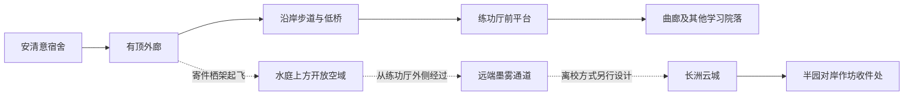

# 山水书院：空间布局与首集航线

2026-10-15｜作者授权继续设计后的助手方案，具体布局尚待采用。承接作者明确的“整个天空与环境都是水墨”的独立空间方向。本轮制作一张总景候选，未建立三维模型。

## 一座能生活、能穿行的园林学校

以学生日常活动构成校园：宿舍外廊、共享水庭、练功厅与通向其他院落的曲廊。高低错落服务于视线与路线，建筑保持亲近尺度。山水书院暂沿用作者称呼，学校正式名称和组织层级仍不由本图确定。

总景视点从学生园居有顶外廊望向水庭，近处柱、栏杆与屋檐遮挡一部分景色；向前走，水面和对岸练功厅逐渐完整出现。移步换景由真实遮挡与空间转折承担，薄雾只在远端局部参与。

| 位置 | 生活功能与视觉锚点 | 本轮状态 |
|---|---|---|
| 近景左侧学生园居 | 安清意所在宿舍组团；黑白外廊包围暖色个人房间；檐下寄件 | 总景提供体量关系，未锁定安清意房间编号、楼层和宿舍制度 |
| 中央水庭 | 日常经过、停坐与眺望；水面形成明亮空隙，桥与倒影交代距离 | 上下水面、低桥、沿岸路和叠水可辨 |
| 右侧练功厅 | 宽敞实体练习地面、可开启界面、面向水庭的小平台 | 图中能见空厅与栏杆，仍缺舞蹈教学细节和仿真切换演示 |
| 中远景曲廊 | 连接学习与生活院落，转弯后显露不同景色 | 主要关系可读，完整通路与高差需灰模验证 |
| 远端墨雾通道 | 继续通往其他院落及校外方向 | 只是方向提示，未确定学院边界构造或离开机制 |

## 步行与快递分别怎样经过

以下为拓扑关系，非按比例平面，不规定地理方位：

步行通过实体地面、台阶和沿岸连接，不借投影承担落脚。设计意图包括缓坡替代通路，但生成图没有充分交代每一级高差的连续缓坡，因此不声称无障碍或全路连通已验证。

快递先从栖架向外撤离檐口与栏杆，再越过水面开放区；不贴着学生走道穿行，也不穿过练功厅或从房间内横冲出去。图中的寄件台仍位于栏杆内侧，下一轮需调整承托位置与开口，配合载具翼展一起验证。本轮不锁定速度、净空或载重数值。

## 首集C段的校园镜头组织

1. **承接宿舍近景：**封好的同一包裹放上栖架，固定完成、手撤开，神鸟起飞。鸟型和装卸结构另设计。
2. **从生活空间拉开：**跟随包裹离开檐口，前景栏杆退出画面，水庭与对岸练功厅显露。总景01承担这一段的环境方向参考，不能直接替代已验证的起飞关键帧。
3. **经过学习空间：**包裹从水庭向练功厅外侧通过；可借敞开界面看见正在练习的学生或一次缓慢场景变化，但不切成与包裹无关的课堂介绍。本图无人，这一动作尚未生成。
4. **离开书院：**到达墨雾渐深的远端。镜头是否通过云雾过渡到彩色长洲，待边界设计确定。不能把当前画面里的远山默认成真的地面山脉，也不能直接确认传送机制。

沿用已定的宿舍联系→展示旧鞋→知夏提出寄件→同一包裹到作坊的因果，保留C段暂定2:20总预算，不为展示总景额外延长校园段。允许剪辑，不承诺一镜到底。

## 水墨空间的层次

近处让柱、石、栏杆保持体积和触感，中段用水面、建筑遮挡和廊桥关系建立可行走的距离，远段让山体与雾化入墨色浓淡。天空也属于这一环境。室内的个人色彩可从小门洞中显露，公共外景保持水墨基调。

学院空间机制先留出两种待比较的解释：同一物理城市中连续包围校园的仿真环境，或具备其他空间技术的独立区域。目前按前者更容易与实体寄件、步行和云城交通衔接来推进镜头设计，但这只是工作假设，未确立为世界观事实。作者若发展后者，既有生活布局仍可复用。

## 当前图像与下一项

见[总景01与审看记录](../视频制作/山水书院总景-20261015-v0.1/README.md)。本图仍有山峰较密、建筑偏传统园林的问题，未来感不应只靠添加灯带解决。

下一项优先把右侧练功厅做成同一空间的两种状态：水墨日常练功与全彩仿真课堂。锁定实体地板、柱网和出入口，再让环境变化；随后将神鸟与宿舍寄件栖架成组设计。以上为后续顺序，本轮没有生成这些资产。
