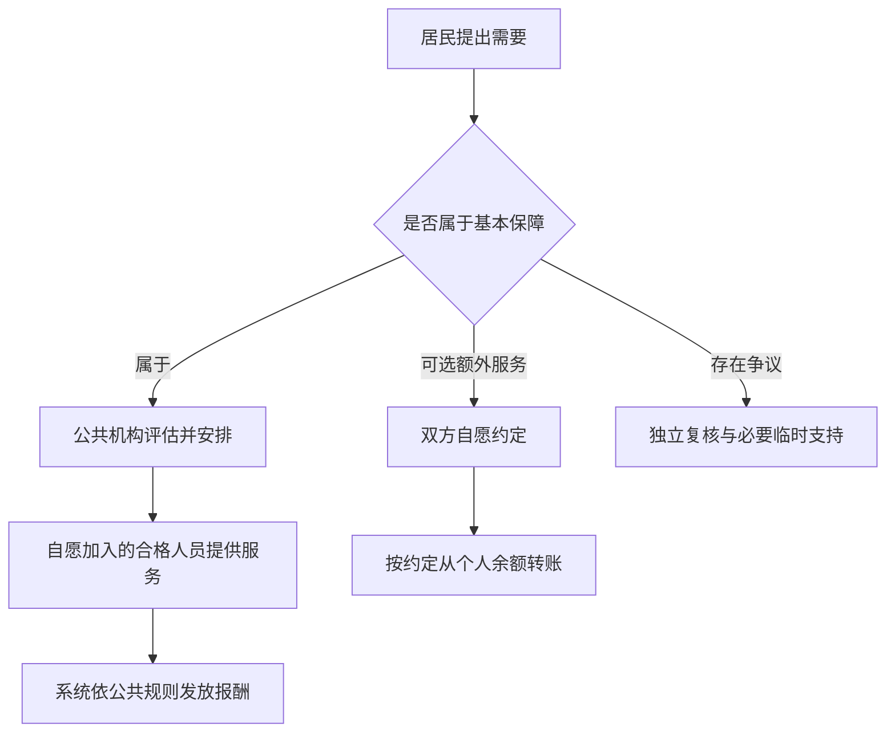

# 文明与精神·卷十二：公共保障与自愿服务

版本：v0.1｜日期：2026-10-07

**已撤回，勿作为现行设定使用。** 作者明确纠正：所有基本生理和心理服务均可由机器免费、充分完成，不需要依赖真人。本文错误带入了“必要服务仍依赖真人供给”的现实前提。保留正文仅作讨论历史；后续以[《机器保障与自愿人时》v0.2](文明与精神-卷十二-机器保障与自愿人时-v0.2.md)为准。下文的方案状态与审查结论均为撤回前记录。

状态：受作者委托深入调查后形成的制度建议。作者已经确认“人时不能成为强制劳动的工具”；本卷的保障范围、人员安排和短缺规则属于本轮提出的具体方案，不冒充作者已逐项确认的设定。旧主设定及医疗卷尚未整体同步。

配套文件：[资料与独立审查](../审查/基本服务保障与劳动自由-资料及审查-2026-10-07.md)、[司法与修复](文明与精神-卷十一-司法与修复-v0.1.md)、[此前讨论纪要](../世界观/讨论纪要-人时续命与财富连续性-2026-10-07-v0.1.md)。

## 一、先把三种权利分开

**基本服务权：** 一个人可以要求公共机构按需要安排必要服务，不必先证明自己有钱、有贡献、讨人喜欢或有亲属愿意照顾。

**劳动自由：** 任何具体的人都有不接受新委托、退出公共岗位和停止未来劳动的权利。公共机构不能把自己的保障责任无限转嫁给某一位老师、照护者或亲属。

**自愿交换：** 基本保障以外，人时可用于支付双方同意的额外服务，也可作为事后赠谢。持有余额不产生征用他人时间的权利。

三者的结合是：居民向公共机构请求保障，机构组织自愿参与的专业人员履行。个人离开，安排责任继续存在。制度需要做的是准备替补、扩大有效供给和处理失败，不能宣布“既然有权利，就必然有一个人愿意做”。

现实参照也区分接受服务的原则与劳动者的自由。英格兰 NHS 宪法按临床需要而非支付能力确定服务可及性；国际劳工组织的解释强调自由、知情的劳动同意及退出。它们并非一套适用于所有地区的统一规则，本卷只借鉴其分工，并采用作者更严格的不以生存逼迫劳动的设定。[NHS 宪法](https://www.gov.uk/government/publications/the-nhs-constitution-for-england/the-nhs-constitution-for-england)、[ILO：强迫劳动的定义](https://www.ilo.org/topics-and-sectors/forced-labour-modern-slavery-and-trafficking-persons/what-forced-labour)

## 二、基本保障不能再按“机器免费、真人收费”划分

建议改成：**必要服务由公共体系保障；可选额外服务由双方自愿约定。机器和真人都可能参与这两类服务。**

判断是否属于必要服务，要看这个人能否安全、有尊严地生活、学习、表达意愿和获得救济，而不是只看岗位名称或服务者是不是人。

| 领域 | 建议纳入免费基本保障 | 可以自愿另约的额外服务 |
|---|---|---|
| 医疗与续命 | 基础医疗、免费蜕皮、必要康复，以及实现知情同意所需的人类解释与支持 | 不影响必要治疗的附加体验或纯个人偏好；不能把必需步骤拆出收费 |
| 心理与社会支持 | 必要心理照护、危机支持、蜕皮适应；低门槛公共倾听与社区参与机会 | 非必要的额外陪伴时段、指定某位名人的交流；仍需对方同意 |
| 日常照护 | 进食、穿衣、卫生、沟通、行动和社区参与所需的适配支持；儿童必要照护 | 超出需要的个性安排、专属礼仪和额外生活服务 |
| 基础教育 | 达到教育目标所需的机器教学与真人指导、无障碍支持、安全监督 | 特定大师的私人传艺、超出基础培养目标的进阶体验 |
| 司法和公共事务 | 必要法律援助、申诉、翻译、无障碍协助、机器无法有效处理的例外人工通道 | 单纯图方便的非必要私人代办；不能向被系统挡住的人收“人工通行费” |
| 基本生活与通行 | 既有机器物资保障，以及真正使用这些保障所需的合理协助 | 手作料理、定制审美、私人导览等可选体验 |

同一项服务可因情境而不同。与某人散步可能是私人休闲，也可能是恢复基本行动和社会参与所必需的支持。认定须说明理由，不能仅凭“这是陪伴”就一律收费，也不能仅凭“我想要”就产生无限供给义务。

尤其需要修订医疗旧卷：既然这个世界的主要痛苦包括孤独、长寿倦怠和意义危机，就不能把涉及这些痛苦的必要照护全部放到个人付费一侧。WHO 的社会联结报告支持认真对待孤立与孤独及其健康影响，也讨论社区层面的支持；它没有证明所有孤独都是疾病，更没有提出分配私人感情的权利。[WHO 2025 报告通俗摘要](https://cdn.who.int/media/docs/default-source/who-commission-on-social-connection/whocsc-plainlanguage-en_comp.pdf)

公共倾听与社区活动可以无需疾病证明即可申请。较密集的个别支持按实际需要评估。社会可以保障遇见人、被倾听和获得专业帮助的机会，不能保证某个人爱你，也不能把建立友情、恋爱或亲密关系列为他人的劳动义务。人可以选择独处，拒绝活动不会扣减其他保障。

## 三、怎样确认需要，而不把人交给一张表

社区公共服务机构设统一入口。它可以使用既有办事系统，不必新增庞大行政层级；医疗、教育、照护等专业团队仍分别负责本领域判断。

1. **先受理。** 申请可以由本人提出，也可在本人同意或适当保护程序下获得协助。不以账户余额和过去贡献筛人；紧急风险先安排临时帮助。
2. **共同确定需要。** 听取本人希望达到的生活目标、现有困难和适配条件，必要时由合格人员评估。只收集完成判断所需的信息，不要求公开全部记忆、创伤史或亲密关系。
3. **给出实际方案。** 明确服务内容、频率、时段或等待上限、适配条件、负责机构、替补安排及复评时间。AI 辅助整理，人类承担争议判断和责任。
4. **有理由、有复核。** 拒绝或减量须说明理由；本人可请求独立复核，不必先证明自己比 AI 更懂专业。反对不适配安排，不等于放弃保障。

“不给你指定某个人”不等于“你的特殊需要都算挑剔”。可理解的语言、创伤安全、隐私、儿童的稳定关系及必要的连续照护，可以是基本方案的条件。机构可以寻找满足条件的其他自愿人员，不能强迫原服务者永久留下，也不能把必要的连续性作为付费升级。

机器若能安全、有效地满足某项需要，可以承担它；不必为了维持真人收费而故意保留障碍。反过来，机器存在也不能自动证明真人支持不必要。应检验其对本人是否可用，不能用机器的一般能力关闭个别申请。

本卷把有效沟通、合理选择和社区参与列入保障，借鉴《残疾人权利公约》第 19 条关于社区生活和必要个人协助的方向。该条不规定本卷的人时机制，也不意味着可以命令一个具体人提供协助。[联合国公布的第 19 条](https://www.un.org/development/desa/disabilities/convention-on-the-rights-of-persons-with-disabilities/article-19-living-independently-and-being-included-in-the-community.html)

## 四、谁来做：自愿岗位必须成为可靠安排

### 1. 把“自愿”与“临时慈善”分开

自愿加入的公共服务者可以是长期受训的专业人员，按公开规则获得人时报酬。自愿不等于无偿，也不等于只能当天看谁有空。

公共体系通过可接受的班次、充分休整、培训、同伴支持、安全保护、减少杂务和明确报酬招募人员。机器尽量承担搬运、检索和重复记录，让真人把精力用于确需其参与的工作。报酬是一种激励，不证明任何岗位必然有人愿做。

加入者事先选择服务领域、能力范围、班次和可接受负荷。专业资格用于确认胜任能力，不是终身征用证；公共培训不得附带无法退出的劳动债务。未成年人不能被当作补足专业缺岗的备用劳动力。

### 2. 公共职责与个人拒绝分别处理

个人可以不接新班次，也可因不适配、安全问题或能力不足退出具体安排。机构必须接续处理，不能因为工作人员轮流拒绝某类人，就将这类人的申请永远搁置。

已自愿承担公共岗位者，在履职过程中须遵守专业标准及平等服务规则；侮辱、报复、故意排斥、滥用排班权限可接受调查。一次拒绝本身不自动证明歧视；有歧视也不能以强制本人提供身体劳动作为纠正方式。机构应通过另配人员、纠正规则、培训和适当岗位处理落实保障，责任措施须有证据、相称且可申诉。

### 3. 可以退出，但要区分退出与独立的伤害行为

不再接受未来排班、终止已经接受的未来安排，以及正在进行的高风险操作，是不同情形。

公共岗位应预先公开有限的通知与交接规则、最长交接时间；具体时限依岗位风险制定，不能由主管临时改成“等找到人再走”。机构承担招募替补和接续的责任。疾病、遭受侵害或无法安全工作的情况下，可以立即停止相关劳动并启动紧急接续。

离岗者在其能力和安全允许范围内及时告知、交还必要资料、协助转交；不得因替补未到就被无限留岗。法庭可以处理未履行部分的预付款、故意隐瞒重大风险或独立造成的可证明损害，但不得把拒绝继续劳动本身、所有未来照护损失和机构长期缺编成本都变成退出罚款。已挣得的报酬不能被扣作留岗押金。

职业限制须针对经证明的能力或安全问题，有范围、期限、复核与恢复路径；不能只因辞任、拒绝未来班次或依法集体停止劳动，就永久剥夺职业资格。紧急短缺也不自动创设强制征调权。

ILO 对退出与合理通知的说明提供了参照，但各地法律和集体协议会有差别，且现实强迫劳动规则存在有条件的例外。本卷不借用这些例外恢复作者已否定的劳动强制。[ILO：劳动自由、通知与经济压力](https://www.ilo.org/resource/other/qas-business-and-forced-labour)

### 4. 亲属不是隐形备用人员

有成年子女、同住伴侣或朋友，不意味着这些人自动承担持续照护。家庭支持只能按真实意愿、能力、内容和期限计入安排，随时变化时应重新评估。

不能因亲属不愿继续帮忙，撤掉被照护者的保障；不能把姐姐曾临时照顾过几天，认作她已经永久接班。监护人对儿童的既有责任须另作明确规定，不能因此推导所有血缘关系都产生无限劳动义务；发生照护中断时先保护儿童并安排接续，再处理具体责任。

## 五、人员退出以后，公共责任怎样接续

基本保障由有名称、可追责的机构承担：社区负责受理和常态安排；本地能力不足时，地区协作网络负责增援和跨区衔接。机构之间怎样结算，不得让当事人反复证明资格或先垫人时。

运行至少包括：

- 按专业、地点、时段和适配条件统计需求与已经自愿确认的可用容量，不能只报全社会总工时。
- 预留经过训练、自愿参加且有休整保障的替补队伍；不能让候补人员无偿全天待命。
- 维护必要的照护连续性和交接材料，跨区移动需本人同意并提供实际交通及沟通支持。
- 定期检查等待、人员流失、重复拒绝、服务中断和未满足需求；不以结案数替代质量。
- 对将要超出等待上限的申请主动升级处理，不能只留一句“请继续排队”。

例如某类服务一周需要 80 小时，本地有 100 小时符合资质和时段的自愿供给，尚有 20 小时余量。突然失去 45 小时，便只剩 55 小时，缺口是 25 小时。追加 25 人时报酬不会自动变出 25 小时真人服务；仍须有合格的人自愿接受安排。这只是算术示例，不能据此确定普遍适用的储备比例。

英格兰照护指导在特定服务提供者经营失败时，规定地方公共机构接续满足需要的临时职责，并讨论中断预案。本卷借鉴“提供者变了，安排责任不应消失”，把它扩展为自己的公共制度建议；不照搬当地的收费、财政和经营条件。[Care and support statutory guidance，第 5 章](https://www.gov.uk/government/publications/care-act-statutory-guidance/care-and-support-statutory-guidance)

## 六、真的缺人时，不能用漂亮话遮住缺口

黄金时代可以把稳定、充足的自愿公共服务设为常态前提，但不能从“机器很先进”推导所有真人需要永远有供给。

人员不足时，按以下顺序处理：

1. 确认风险，立即提供实际可用的临时安全措施；机器、远程或群体形式只有适合本人时才算有效替代。
2. 联系已确认的自愿替补和跨区支援，改善临时工作条件，并调整可延期的安排；既有当事人的需要不能无声消失。
3. 按紧急性、拖延造成的损害、服务适配性及累计等待作出分配。相关条件相近时可依公开顺序或抽签，不能按人时余额、人气、过去贡献或关系排队。
4. 说明仍未兑现的服务、临时方案和下一次复评时间。保留原申请及等待历史，提供独立申诉。
5. 对可避免的缺编、压低保障、歧视分配和隐瞒中断追责；若资源确实已尽合理调配，承认仍然发生了未满足需要，继续组织补救。

持续非紧急需要也必须有服务容量和等待上限，不能每次都被新来的紧急案件无限推后。任何临时压缩都须有期限、原因和恢复安排。短缺分配的规则须事先公开、可复核，不能由 AI 用一个“社会价值分”决定谁更值得照顾。

WHO 的短缺分配框架强调多种相关原则、公平程序、透明和可质疑；还提醒紧急情形中的先到先得可能偏向信息和交通条件较好的人。本卷借鉴这些程序思路，不将疫情期间具体医疗资源的优先规则推广为所有社会服务的统一公式。[WHO：资源分配与优先次序](https://www.who.int/news-room/questions-and-answers/item/coronavirus-disease-covid-19-ethics-resource-allocation-and-priority-setting)

**无法同时无条件保证：所有人随时自由退出、所有真人需求当场满足、任何时候都没有供给短缺。** 本方案保留劳动自由与可追责的保障制度，以储备和调配使缺口尽可能少；发生缺口时必须承认服务暂未兑现，不能把未兑现改名为“需求不必要”，也不能转为强征劳动。

## 七、人时在哪里出现，在哪里不该出现

**基本保障侧：** 受助者不扣个人余额，不负欠款，不需要以后劳动偿还。服务者按公开规则获得公共报酬。服务记录要能核实质量和实际履行，不能只奖励累计时长；必要准备、交接和约定候补应明确计酬范围。

**私人额外侧：** 延续卷十一的方案，由承担报酬约定者转出人时，发生争议时适用司法程序。无偿帮助和事后赠谢继续存在。

**发放来源：** 公共人时究竟新增发行，还是从公共账户划拨，本轮不擅自替作者定案。若采用新增发行，就不能再宣称“有真实服务所以绝不可能购买力变化”；持续新增、完整积蓄与未来自愿服务容量之间仍须核算。若采用账户划拨，就必须解释无税条件下账户来源。无论采用哪一支，发余额都不等于完成排班。

旧稿“每月发一些兜底人时，就保证每个人被认真对待几小时”需要改写。余额只能增加交换的可能性；实际保障应是可申请、有人负责安排的服务。兜底余额是否作为额外自主选择继续保留，可另行决定；这不是取消个人积蓄、赠与或继承。

## 八、防止免费的入口被悄悄变成收费入口

允许同一位专业人员自愿承担公共和私人服务，但公共班次与私人时段应分别安排。不得将公共排队资格出售，不得同一服务既领公共报酬又向居民收费。

参与需要认定或预约分配的人，不得人为延长等待、压低基本方案，再诱导当事人购买自己的私人服务。拒绝送礼、不给额外感谢，不得影响公共资格和服务质量；公共岗位不能沿用私人交往中“关系好就多照顾”的分配方式。足以影响当前决定的礼赠须回避处理，不能借“完全自由赠与”掩盖职务交换。

当公共机构无法按时提供必要服务时，应优先安排合格替代，必要时由公共体系直接与自愿私人服务者约定承接，居民无需先垫付。已有迫切、合理的自行替代支出，可以申请独立审查；不能一律因未事先获批而排除救济，也不能让所有私人委托自动获得事后报销。

机构失约后的首要补救仍是实际服务接续。赔偿或补发人时另行处理，不能代替照护；同一损失不得重复补偿。公共人员受侵害时也享有保护，不能要求其为了维持连续服务独自承担暴力风险。现实 GMC 指导亦强调这类情境下的团队接续与工作人员安全；本卷的具体分工属于虚构制度设计。[GMC：工作场所种族歧视与服务接续](https://www.gmc-uk.org/professional-standards/ethical-hub/racism-in-the-workplace)

## 九、三种方案的取舍

| 方案 | 好处 | 关键问题 |
|---|---|---|
| 只发兜底人时，让每个人自己找服务 | 接近现有余额设定，个人选择直观 | 没人接单时保障落空；最难沟通、最不受欢迎的人可能被排除 |
| 将公共服务列为普遍强制轮值 | 表面上容易分配每个人的义务 | 违背作者已经确认的劳动自由；资质、负荷和真正愿意参与仍不能靠轮值解决 |
| 公共机构负责安排，自愿专业人员参与 | 将居民资格与个人劳动自由分别保障；允许长期专业协作 | 需要真实人员储备、短缺预案和问责，不能许诺绝对即时满足 |

本卷推荐第三种。它保留人时在私人生活中的意义，也避免人的基本尊严取决于别人是否喜欢他。

## 十、小说中的压力情境

| 情境 | 本方案怎样处理 | 可以留下的矛盾 |
|---|---|---|
| 一个人没有积蓄，也不擅长与人交往，需要心理帮助 | 公共入口按需要安排合格支持，无须先挣钱 | 得到专业倾听之后，仍可能渴望真正的朋友 |
| 居民只信任即将离岗的照护者 | 评估连续性需要，自愿安排过渡和其他适配人员 | 制度能减少断裂，不能命令人永远留下 |
| 学生用机器课一直学不会 | 提供必要真人指导，不先要求购买名师课 | 基础支持得到保障，不等于能拜最仰慕的人为师 |
| 某人拥有很多人时，想买下公共心理师的当天名额 | 不能购买公共优先位次；另约私人时段仍需自愿且不得侵占公共班次 | 有积蓄仍会遇到边界 |
| 两名照护者同时病休，另一人拒绝超负荷加班 | 启动候补与跨区接续，记录实际缺口；不能惩罚其拒绝加班 | 一个没有坏人的局面，也可能让人暂时得不到足够帮助 |
| 家人不再愿意做全天照护 | 重新安排公共支持；监护等具体义务另行审查 | 爱可以真实存在，同时也需要休息和距离 |
| 当事人因创伤拒绝某种接触或某位服务者 | 评估安全、隐私和适配条件，寻找可接受替代，不自动视为放弃 | 合理需要与有限供给之间仍会有等待 |

## 十一、与已有设定的同步清单

本卷是新提案，下列旧表述不能与它同时作为完整现行规则使用。保留旧版本，以便作者看到变化。

| 位置 | 应按本方案修订的内容 |
|---|---|
| 主设定 2.3：兜底人时保证被认真对待 | 将余额补助与实际服务保障分开；不以到账替代交付 |
| 主设定 3、4：机器免费、真人付费的绝对双轨 | 改成必要与额外的分界；保留机器与真人的文学差异，但不据此决定全部收费 |
| 主设定 6.7：机器办事免费、人工跑腿收费 | 必要人工纠错、无障碍与申诉免费；纯便利代办可另约 |
| 主设定 8.7：真人教学全部花人时 | 达到基础教育目标所需真人支持免费；稀缺名师额外传艺另论 |
| 医疗卷八：机器治身体免费、真人治心灵收费 | 将必要心理、康复和适应照护纳入基本保障；免费蜕皮同步此前决定 |
| 司法卷十一第五节第 2 项和照护余额案例 | 不再以“必要照护必须个人支付”为例；债务执行仍须保留合理自主生活、额外选择及未被公共保障覆盖的必要个人支出，不能因基础免费而扣光余额 |
| 司法卷十一第五节：违约与劳动自由 | 公共岗位退出同样不得强制劳动或无限赔偿；具体危险行为另依证据追责 |
| 启智分、轮值义务等相关表述 | 不得将未参与公共劳动作为削减基本保障的理由；更广泛的贡献评价与治理参与规则另行核对 |

本轮完成的是服务范围、申请、用工、接续、短缺和救济的制度建议。公共人时发行及长期供需总量仍是下一项需要单独闭合的设定；这不能靠照搬现实税收，或默认为所有人最终总会愿意劳动来解决。
