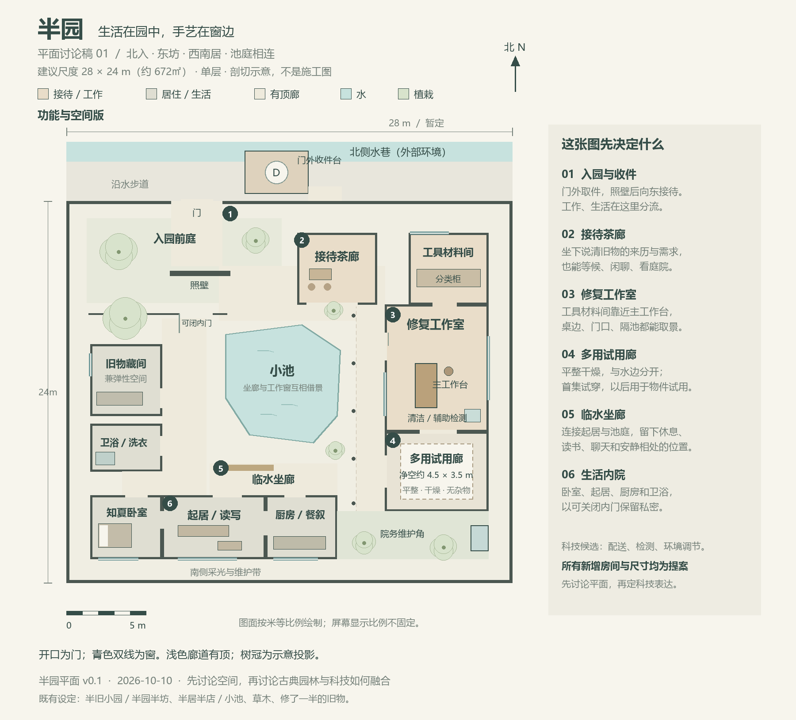
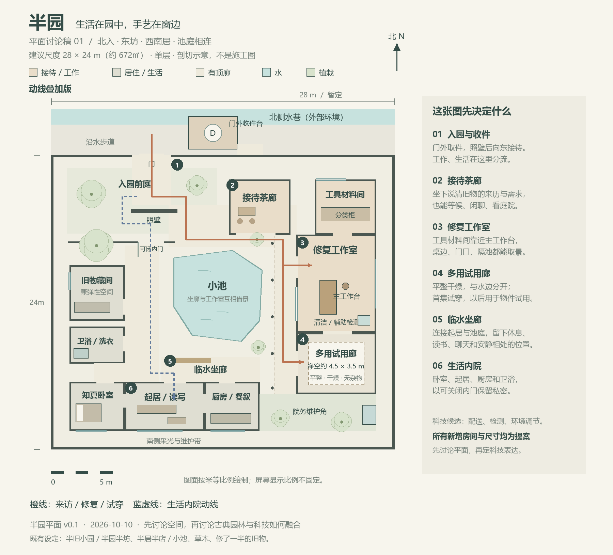

# 半园平面草案 v0.1

2026-10-10｜待作者讨论与修改。用户要求先画长期场景的平面，再讨论中国古典园林与现代科技的融合；本轮不重建三维模型，不冻结美术或房屋设定。

## 已有设定与本次假设

已有设定：半园是长洲老城区的半旧小园，半园半坊、半居半店，有小池、草木和修了一半的旧物；原为阿姐居所，使用权赠给知夏。常住者是知夏与汤圆。首集需要收件、检查、修复、复核、试穿及交还。

本稿新增且待定：约28×24米、672平方米院界内用地；单层；北侧临水入口；东侧接待和工作；西南生活；中央池庭；具体房间、门窗、池形及家具位置。总用地不等于建筑面积，也不是作者已经批准的住宅规格。对照桌椅、床与5米比例尺判断大小。

旧航线灰模中半园80×45米是占位。本稿不在旧占位上铺满房间；采用平面后，需重新对齐城图、半园入口、门外收件台和摄影机，不能沿用旧检测结果宣称新尺寸已经试飞验证。

## 为什么这样放

**北入、东坊、西南居，池庭相连。** 来客从北边进园，照壁稍作转折，能向东看见接待茶廊。接待、材料间、修复室与试用廊相邻，减少搬着旧物往返。来客不用穿过卧室、厨房或卫浴。

西侧有可关闭的内门，连接旧物藏间、卫浴及南侧生活房间。卫浴至卧室用连续有顶通道相连。起居和厨房有面向内院的入口，也有室内相通的门；不用为每个生活动作绕池走一圈。旧物藏间兼弹性空间，具体是否保留为独立房间可在讨论中缩并，不增设阿姐纪念室或额外住客房。

小池承担视线和停留关系：修复窗望向水和坐廊，坐廊能看到知夏工作；客人说话、独自读书、汤圆在旁陪伴，都可以在同一个空间体系发生。生活区有可关闭的房门，坐廊可按情境邀请来客使用，并非所有访客都可随意进入。

试用廊留约4.5×3.5米的无家具范围，平整、干燥，和水边分开。首集适合走步和有限的试穿反馈；它不是专业舞室，也不意味着所有舞步已验证。以后可用于其他旧物的装配、试用或临时摆放。池东主要廊道暂按1.8米宽留出，不塞设备柜和花盆；柱子置于廊外侧。

门外收件台靠近主门但与入园口错开，配送机停稳后取包，再由人带入工作区。它与沿水步道、岸线及起落净空的精确衔接，留待半园和水巷合图时验证。院务柜从院内到达，暂只预留维护用途。

## 用于长期拍摄的空间关系

| 位置 | 可持续使用的场景与取景 |
|---|---|
| 门与照壁 | 来客初次到访、知夏送客、无人机到件；入园后逐步显露池庭 |
| 茶廊 | 说清旧物来历、讨论使用需求、朋友等候与闲聊 |
| 工作室 | 桌边手艺特写、门口斜看知夏、隔池看工作窗；工作台位置可随最终修复动作调整 |
| 池与坐廊 | 休息、读写、观察天气与光线、与汤圆相处；保持安静日常的空间 |
| 多用试用廊 | 交还前试用、比较结果、轻松的小意外；避免每集都得再搭试用场地 |
| 西南生活区 | 起床、吃饭、读书、生活整理；首集不要求所有室内出镜，但长期布局先有位置 |

## 古典与科技：本轮只留讨论位置

平面先使用院、廊、池、照壁、窗与门组织行走和观看。现代生活所需的卫浴、洗衣、厨房、收纳也占有真实位置，不能让人物住在只适合参观的古建展馆。

下一轮可用四个位置讨论融合方式，而非一次定死全屋风格：

1. 门外收件台：自动配送如何接进临水园门，设备呈现多少存在感。
2. 修复工作台：手工工具与辅助检测怎样并置；是否使用可收起的界面，尚未决定。
3. 窗与檐廊：采光、遮雨和环境调节怎样结合；不预设所有窗都变成屏幕。
4. 院务维护角：回水、清洁和环境设备的候选位置，尚未做管线或机电设计。

可以讨论“多数技术融进构件、少数使用点清晰可见”的方向；这不是已经采用的科技美术规则。本轮不绘制悬浮家具、全屋投影、发光线条等额外设定。

## 动线讨论图

橙线表示来访、修复与试用之间的关系，蓝虚线表示从前庭进入生活区的路线。线条展示关系，并非人物必须每次按此精确轨迹行走。图中开口为门，青色双线为窗；没有门扇的开口需要下一版逐处明确门型。

## 本轮核对

已进行独立对抗性审查与图片检查：修复主线、生活分流、卫浴至卧室的遮雨连接、试用廊用途、标签可读性；修正了生活线压北门门框的位置。输出是按米绘制的概念平面，不是施工图，尚未核验结构、设备、排水、边缘防护或真实舞蹈动作。未修改旧航线、世界观主设定或Toonflow画布。

文件：两张PNG供浏览，两张同名SVG供编辑；`draw_plan.py`可重绘。下一轮优先讨论总体尺度、居住与工坊的比例、池庭的开放程度，再深化材料和科技的可见方式。
