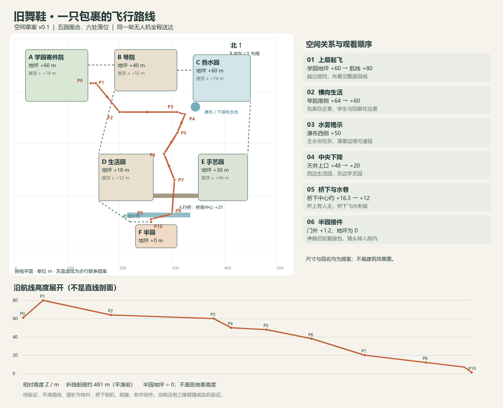

# 舞鞋包裹：无人机航线与园院空间 v0.1

2026-10-10｜空间提案，待作者审阅。无人机配送已获作者确认；本稿园名、尺寸、高差、航点和水路是布局提案，不是全城地图或已验证的建筑工程。先审空间，再制作资产。

## 1. 一句话空间构想

**上层学园出发，沿中层园院外缘飞行，擦过瀑布侧面的薄雾，从园院围出的开敞天井下降，再顺老城水巷到半园。** 全程同一架无人机、同一只稳定托架、同一包裹，不换乘升降平台或水上载具。

用五处园院围出一个中央开敞空间，半园置于南侧低处。园子有各自边界、用途、日常入口，也通过步行桥和折返楼梯连接；无人机使用外侧净空，行人在园里和回廊上活动。城不是把孤岛随意撒在云中，也不是一块平地上堆古建。

工作名仅用于辨认空间：“学园寄件院、琴院、叠水园、生活园、手艺园”。暂不取一批正式园名。沿途花窗是借景框，不是无人机必须钻过去的洞。

## 2. 坐标、边界与高差

局部研究范围 500×430 米，不代表长洲全城。俯视图上北下南：X 向东增加，Y 向南增加；Z 以半园地坪为 0，全部是城内相对高度，不是离地面/太湖高度。

| 园院 | 俯视边界 X / Y（米） | 地坪 Z | 暂留最高屋顶 Z | 相邻关系与用途 |
|---|---|---:|---:|---|
| A 学园寄件院 | 20—140 / 20—120 | +60 | +78 | 西北高处，舞院临廊与寄件台；东侧外缘起飞，不穿教学区 |
| B 琴院 | 190—310 / 20—100 | +40 | +55 | A 东侧、低 20 米；能从南侧航道看见临外缘的练琴廊与学生 |
| C 叠水园 | 340—450 / 30—120 | +60 | +74 | B 东侧、回到上层高度；南侧水口落向 +24 的收水池，制造视觉地标 |
| D 生活园 | 160—265 / 220—310 | +18 | +32 | 天井西南侧；临外回廊有早餐、晾晒、花木等日常 |
| E 手艺园 | 350—445 / 220—310 | +30 | +46 | 天井东南侧，比生活园高 12 米；只见工坊外廊与工作剪影，不承担本集修复课堂 |
| F 半园 | 230—310 / 355—400 | 0 | +12 | 最低南侧老城；北侧临水入口收件，门内是池边工作台 |

中央下降空域的核心边界：X=275—330，Y=175—290。它是园院之间的真实空隙，不是穿过一座楼的虚构井道。地坪和屋顶包络应分别建模，不能只用平面图判断机位可通行。

人行联系：A—B 经北侧折返梯廊相连；B—C 经北侧桥及上行台阶相连。B 向 D、C 向 E 的下层步行联系沿各自外侧布置，留出中央空域。D—E 在 Y≈300 处架一座步行桥，两端接台阶，桥中心桥面暂为 +24、桥底 +21。D 的南侧步道沿西岸下到半园门前，不与无人机下降线共用。

这些是连接关系与预留走廊，尚未完成阶梯踏步、结构支承、护栏与桥坡的工程设计。不能把布局图当成可施工图。

## 3. 单架无人机的航点

航点数据另存 [JSON](无人机航线-v0.1.json)，供后续灰模与机位复用。航点为无人机中心位置；局部曲线平滑时必须保持在预留空域内，不能直接套样条穿入园院。包裹在刚性托架内，保留统一识别色块，不使用长绳吊运。

| 点 | X,Y,Z（米） | 动作与看到的空间 |
|---|---|---|
| P0 | 145,85,61 | 学园东侧外伸寄件台装载；平台地坪 +60，台面需在灰模中落实 |
| P1 | 155,85,80 | 在园院外缘上升，墙后园城显露；不是从屋檐内部拔高 |
| P2 | 200,140,64 | 绕到琴院南侧，远看临廊学生，包裹留在近景 |
| P3 | 310,140,60 | 沿琴院南外缘向东，叠水园与瀑布进入前方视野 |
| P4 | 325,145,50 | 经过瀑布西侧约 25 米的薄雾边缘；不穿主水帘，视线仍可辨 |
| P5 | 310,180,48 | 转向南，进入中央空隙的上口 |
| P6 | 285,220,38 | 轻弧下降，生活园屋顶与东侧手艺园回廊形成前后错层；手艺园生活画面放在 P5—P6 |
| P7 | 305,270,20 | 继续下降，西侧看生活园临空外廊，东侧仰看高处手艺园的基座；此时不再默认看清手艺园地坪上的人物 |
| P8 | 300,335,12 | 从步行桥下方的预留通道通过，进入沿水老城段 |
| P9 | 260,345,7 | 顺水巷减速转向半园北入口，摄影机逐步靠近人视高度 |
| P10 | 260,350,1.2 | 门外收件台停稳，知夏从门内接包；不飞到工作台上吹动针线 |

无人机概念包络暂取约 2.4 米宽、2 米高（包含托架、包裹及布局余量），仅用于预留空间，不是已确定的设备规格。桥下航段按 P7→P8 线性中点估计，Y=300 时机体中心约 +16.3，低于桥底 +21；余量需连同无人机包络和摄影机在灰模中复查。

本图的路线不取几何最短线：从高处学园到低处半园，沿园院外缘与开敞天井下降，绕开居民的院内活动空间。这个理由成立即可，不编造强制检查站或绕城配送制度。

## 4. 摄影机怎样和无人机配合

摄影机不是无人机自带摄像头。观众需要反复看见包裹与载具，才能把城市景观连回修复委托。

| 段落 | 主要拍法 | 摄影机的空间约束 |
|---|---|---|
| P0—P1 | 从同学松开包裹的手开始，侧后方随升，院墙退下，园城第一次展开 | 机位在起飞台外侧，升起线在 A 东边界之外，屋顶不透视 |
| P1—P3 | 与无人机侧向并行，近景包裹、远景琴院学生；短暂拉开，读懂园院连桥 | 摄影机留在外侧空域，不能穿进琴室取景后又假装一直跟飞 |
| P3—P5 | 水雾短暂降低远处对比，出雾后中央天井展开；可作一次自然遮挡切点 | 主水帘在东侧，载具从西侧薄雾边缘经过；摄影机同侧，无遮挡时不突然调换左右 |
| P5—P7 | 先俯看下降路线，再切/绕到侧面；P5—P6 看手艺园回廊，P7 已低于其地坪，改看基座与生活园外廊 | 相机可用航线周边约 8 米的初始走廊试拍，实际视锥、枝叶及建筑仍待灰模核验 |
| P7—P8 | 先看见桥上行人，随后桥底从上缘掠过，打开下方水巷 | 桥下机位高度暂限 +14 至 +17，不在桥板内抬升；桥体遮挡可切镜 |
| P8—P10 | 速度与机位一起降低，声音变近；停稳后知夏入画接包 | 靠近收件台时恢复固定或小幅移动，清楚看到同一只托架与手的交接 |

视觉节奏：上升惊喜 → 横向生活 → 水雾揭示 → 纵向开阔 → 老城亲近 → 接件安静。穿越机感集中在 1—2 个约 15—30 秒的候选连续段，整条路线允许剪辑，不承诺一次生成或全程长镜头。

原细纲的飞行展示 5 分钟是上限，包含装载、空域节奏、沿途生活与到件，不代表以固定速度不停飞 5 分钟。航线真实长度由数据计算，速度与停留在灰模试拍时调整；若景观重复，直接缩短，不用故障、撞险或反复盘旋填时长。

## 5. 水、雾与空间的关系

叠水园水口暂设在 (345,130)，水面约 +58，落入同一平面位置的 +24 收水池；水口位于南缘外伸的水景构筑物，必须在灰模中留支承和集水边界。图上一个标记同时表示高处水口和下方池体，不能把两者画成同一高程。

薄雾集中在瀑布侧面与收水池附近，来自溅散水滴；不是所有水面都自动冒白雾。远景可有柔和水汽，近处航道与人物必须清楚。水景采用局部循环方案：收水与回水设施藏在园院构造中，不用无尽落水遮掉下层街道。南侧老城水巷为另一段水景，不假定这条瀑布直接冲进半园。

## 6. 半园的落点决定最后一个镜头

F 北侧入口面向水巷，收件台 P10 在门外。收件台与门之间留出人站立、伸手接包的位置；临水步道有边界，起落空间朝水面敞开。半园主入口由北入，工作台设在门内偏东、靠池边的明亮位置（具体桌位下一轮局部平面再定）。

无人机停稳后，知夏从门内走来，拿出包裹；托架保持固定，旋翼/动力系统按设备方案停转或进入不扰人的收件状态。镜头跟她过门再到工作台，飞行声退去，留下包裹纸与布的声音。包裹从发件同学的手到知夏的手是完整动作链。

## 7. 微缩模型与后续资产的边界

下一步如采用本路线，先做三维灰模/微缩体块验证：A/B/C/D/E/F 六块边界、地坪与屋顶两层包络、桥、台阶预留、瀑布/收水池、无人机航点及关键相机。细瓦、门窗纹样、花木种类暂不细化。

实体体块模型可先按 1:1000 讨论：研究范围约 50×43 厘米，最高航点约 8 厘米；这适合看园院关系，不足以检查角色、门洞或旋翼细节。半园收件局部日后另用更大比例。比例仅为提案，未下单或制作模型。

通过空间审阅之后才制作：一套无人机/托架与包裹；舞鞋状态；三位主要角色；半园必要空间；上述路线中实际入镜的园院外立面。取消此前共享配送载具、升降换乘平台和水上末端载具的资产需求。

目前完成的是平面/高度设计与静态示意，没有三维碰撞、镜头视锥、空气动力、结构工程或生成稳定性验证。不能称为飞行链路实测通过。

## 8. 独立审查记录

图文与航点数据完成独立只读核对，折线航程约 481.1 米。修正了低处 P7 不可能直接看清高处手艺园回廊的问题，将该画面提前到 P5—P6。按当前直线航段和桥底中心高程估算，穿过桥宽时载具计入上下各 1 米包络后的最小竖向余量约 3.2 米；这不是完整桥体、平滑曲线或摄影机碰撞验证。下一步仍先由作者审空间关系。
